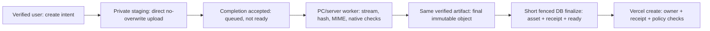

# B16 — Direct upload, worker verification and creation readiness

- Task/owner: B16 / Codex(Backend), Master `msg_f4b770bb88d8`.
- Status: **ready_review — architecture only; no implementation or provider operation**.
- Original check:2026-11-17 21:37 KST; **B16-FIX checked2026-11-17 21:52 KST (12:52 UTC)** under Master `msg_705da9ab254e`, responding to B16-R `90c46f7` F1/F2. This is a design correction awaiting independent re-review.
- Sources/configuration checked2026-11-17; actual account plans/buckets/limits were **not** inspected. A personal “Pro” subscription is not evidence of Supabase organization/project billing or Vercel plan.
- Current source baseline inspected `8ffe3c75b5eaa908ee000f574cf688dd65125378`; B14 `ba3ad44`, B15 `1d561c1`. Only this report changes. B15 review files frozen.
- Later B17 `a7cb6d3` observed exact organization Free/global50MB/no bucket and Vercel Hobby; this supersedes actual-plan uncertainty in the original B16 research below. B18 comparison checkpoint is separate and no purchase is authorized.

## Recommendation and current limitations

**Browser uploads directly to private quarantine Storage. A separate PC/server worker verifies actual bytes and publishes an immutable final object plus durable receipt/asset record. Vercel project creation performs short owner/readiness/receipt queries only.** Do not connect B14's native video/temp/full-download path to a Vercel HTTP creation request. Do not replace verification with a client boolean or bare object metadata.

Current B14 streams to disk, hashes/counts, sniffs/decode-checks images, invokes ffprobe and then removes its scratch artifact. Its total timeout is≤60s and scratch usage can approach the declared file size. B15 runs that verification **while holding asset FOR SHARE inside a PG transaction**, with≤10s signal budget against the existing15s idle-transaction setting. Neither is a practical2GB serverless request contract; tests prove isolated local correctness, not throughput, native-binary deployment or long-file readiness. Cancellation cannot abort already dispatched COMMIT, OS cleanup or all native work at an exact millisecond.

Existing worker/main and jobsService are **SQLite/mock/render** execution, with60s lease,20s heartbeat and attempt checks. They are not a cloud upload verifier or a PostgreSQL job dispatcher. A new isolated storage verification entry point is required; simply adding a new job.kind to the current runner would enter unrelated generation paths. PLAN P7-4's future pg-boss work is separate; this proposal uses a domain intent/lease, not a new general queue framework.

B15-R acceptance is limited to the unconnected trusted-server contract. A real successful COMMIT followed by lost response can produce503 while durable project/stage/link/audit rows remain. Future creation UI/API must classify this as **outcome unknown**, query owner-scoped operation status and reconcile before retry;503 is not evidence that creation failed. Add a separate durable owner+creation-request idempotency/status contract before enabling automatic retries; upload-intent idempotency alone does not deduplicate project creation. A trusted pool can rewrite same-owner SQL and is not sandboxed; an in-flight pg_sleep abort is not a hard deadline. B15's original19/B12 regression20/focused97/independent18 checks overlap and must not be summed as distinct coverage.

## Current primary-source limits and installed SDK

| Source checked | Verified fact / implication |
| --- | --- |
| [Supabase file limits](https://supabase.com/docs/guides/storage/uploads/file-limits) | Free file cap50MB; Pro+ configurable global cap up to500GB. Bucket cap cannot exceed global cap. Existing application maximum is exactly2×1024³ bytes; Free cannot provide that range. Eligible plan and both configured limits must accommodate2,147,483,648 bytes. Do not silently reduce the product limit. |
| [Method limits](https://supabase.com/kb/troubleshooting/upload-file-size-restrictions-Y4wQLT) | Separate upload-method ceilings apply; documented resumable/S3 support up to50GB covers2GB, subject to plan/global/bucket caps. A larger plan cap alone does not override a method cap. |
| [TUS guide](https://supabase.com/docs/guides/storage/uploads/resumable-uploads) | Recommended above6MB; documented6MiB chunks, direct Storage hostname, signed token via x-signature, resumable resource up to24h and first-completion conflict behavior without upsert. Individual signed URLs are not revocable. TUS support does not grant Free a larger size allowance. |
| [Signed upload reference](https://supabase.com/docs/reference/javascript/storage-from-createsigneduploadurl) | Upload capability valid2h without further authentication. Installed SDK2.119.0 accepts path/upsert, not a caller-defined expiration argument. Application intent expiry cannot shorten an issued provider capability by itself. |
| [Vercel function limits](https://vercel.com/docs/functions/limitations) / [runtimes](https://vercel.com/docs/functions/runtimes) |4.5MB HTTP payload limit, finite plan-dependent duration, bounded memory/bundle; writable instance-local scratch up to500MB. A2GB upload/spool exceeds this scratch/body architecture. Streaming alone does not remove finite execution/resource limits. |
| [Storage ownership](https://supabase.com/docs/guides/storage/security/ownership) / [access control](https://supabase.com/docs/guides/storage/security/access-control) | Provider owner_id derives from JWT subject; service-key/dashboard resources may lack it. Ownership alone is not access control; service credentials bypass RLS. App asset owner must come from verified intent/Auth authority, not guessed provider owner or client metadata. |

Installed supabase-js/storage-js **2.119.0** source confirms `createSignedUploadUrl`, `uploadToSignedUrl`, download.asStream; upsert permission is determined at signing, not fixed by a later uploadToSignedUrl option. Actual hostile header/upsert/replay behavior must still be tested against a separately assigned provider test bucket before readiness. No tus-js-client/Uppy entry was found in current package-lock; adding a pinned TUS client requires its own future implementation scope, not an installation here.

The TUS guide has no consulted Pro-only protocol restriction; Free remains bounded50MB. PLAN P7-2 already calls for Storage(Pro,TUS,direct browser upload). Existing project billing/limits are unknown, so neither upgrade nor cost is assumed authorized by an unrelated Pro account.

## Proposed data path

| Phase | Required contract / atomic boundary |
| --- | --- |
| Intent | Verified server actor creates owner-bound intent and reserved UUIDv7 asset ID; explicit bucket, unique unpredictable staging nonce, cap, expected upload properties, policy version, expiry and owner-scoped idempotency key. Client SHA/MIME/size are claims, never verification evidence. Small JSON request only. Persist intent before issuing capability; never accept caller bucket/URL/owner. |
| Signed direct upload | Sign only the intent's private **incoming** path with upsert=false; return narrowly scoped bearer capability to that user, never service key. Configure exact provider-issued TUS endpoint, not an assumed host. Browser data goes to Storage, not Vercel. Bound bucket/global limits and deny user UPDATE/DELETE/rename/copy/move/final-prefix writes. Capability replay/hostile x-upsert must not overwrite an existing upload; require a real negative acceptance test. |
| Completion receipt | Authenticated owner submits intent ID/idempotency key only. First resolve an already-committed matching operation/result; only an incomplete operation then needs live owner/state/expiry authority. Atomically mark completion-requested/enqueue once. Client success/webhook/metadata is not verification. Pending means not ready; duplicate terminal completion returns the same result even after original intent/lease expiry. |
| Worker claim | Short DB lease claim with server time, monotonically increasing attempt/fence and opaque lease capability/worker principal; heartbeat and conditional renewals. Commit claim before any network/native work. No DB row lock or open transaction during the long download, inspection or upload. Worker loses authority on expiry/cancel/new fence. |
| Verify staging | Read exact bucket/key from authoritative intent. Download full stream to private owned scratch with byte cap/time/cancel, compute actual SHA/size, detect allowed MIME, full image decode/pixel bound or video duration/probe. Compare any client expectations; wrong/corrupt/overlimit fails. Record verifier code/policy/tool versions. No client-controlled ffprobe path, URL or local filename. |
| Publish final | Compute canonical owner/asset/SHA/extension key; **commit exact publication reservation before external upload** under the object barrier described below. Upload from the same verified scratch artifact, no overwrite/remote mutable-source copy. Hash transmitted bytes and independently verify final bytes, or prove equivalent version/checksum identity; ETag is insufficient. Collision requires exact identity+bytes reconciliation. No external write if reservation commit is unknown. |
| DB finalize | First owner-scoped matching terminal-result lookup; otherwise lock policy→object barrier→operation→asset/state, verify live operation fence/lease/expiry/owner/cancel/policy and publication not cleanup-claimed. Atomically register immutable object/asset once, append receipt and commit current state/audit/result/outbox. Reverification appends a receipt for the existing object without asset reinsertion. All details and GC exclusion are normative below. |
| Vercel create | Join actor-owned nonarchived asset to current unrevoked ready state and immutable receipt with matching asset/bucket/key/SHA/size/MIME/policy epoch/validity. Use short locks only on asset/ready state during existing project/stage/link/audit transaction. **No stream, scratch, Sharp, ffprobe, worker wait or metadata-only Storage fallback.** Missing/expired/revoked/forged evidence fails closed. Current B15 default is not changed by this design. |

Separate quarantine and final namespaces/buckets are required; only staging gets user upload capabilities. A browser must never receive a token authorizing the canonical final key. Provider storage.objects.owner_id may be null/service identity rather than the app user; key/intent authorization plus measured final registration is explicit. Preserve existing assets.owner_id→auth.users FK and actual DB owner checks.

## What a trusted receipt proves — and does not prove

Receipt is append-only trusted worker attestation, **not `verified=true` supplied by the client**. Bind at least owner/intent/asset IDs; source bucket/key and observed source identity; final bucket/canonical key and provider version if genuinely supported; exact measured byte SHA/size/MIME/kind/dimensions/duration; policy ID/digest, verifier source/tool version, worker principal, attempt/fence, completion time and expiry. Store canonical receipt digest and issuance provenance. Only the restricted finalize path may issue it; web runtime/user roles cannot insert, edit, replace or self-approve it. Worker compromise is a trust failure; a digest is not remote/hardware attestation that ffprobe ran.

Lightweight acceptance is justified **only while** final write/delete/copy/overwrite authorities are constrained and all supported lifecycle changes invalidate readiness first. Canonical hash naming does not itself prevent overwrite. SDK versionId support does not prove hosted immutable versions/Object Lock; none was verified. Do not market ordinary private buckets as WORM.

Every registration tuple must exactly equal its receipt; checks run under actor RLS and companion-state lock, not an untrusted cached browser receipt. Policy epochs permit server-side revocation/reverification. Receipt not_after is explicit and policy-controlled: expiry blocks **new reference admission**, queues revalidation and never rewrites history. Final timeout/retention policy values require later operational sizing; a suggested short application-intent lifetime is not a signed-capability lifetime.

Point-in-time verification/HEAD cannot prove future bytes. Arbitrary provider admin/service-role deletion after the transaction is not preventable by this DB receipt. If such authority is exercised outside the controlled lifecycle, mark affected receipt unavailable/revoked and reconcile/reverify; until detected, availability can be stale. Downstream use still needs its own identity/hash safety. Security equivalence to full per-use hashing is not claimed against a privileged adversary or unknown mutation path. Lack of enforceable final mutation authority is a **readiness blocker**, not justification for a bare ready flag.

## Lifetime, cancellation, races and compensation

| Situation | Required outcome |
| --- | --- |
| App intent expires/cancels | Stop new acceptance/issuance/finalization of incomplete upload operations; signal worker and fence through the shared barrier. Already-committed terminal results remain queryable. Already issued capability may write staging; no immediate revoke claim or whole-project key rotation. Reverification uses separate authority, not the expired original upload intent. |
| Provider token / TUS expiry | Track every capability issue/reissue and latest expiry without logging its token.2h signing and up-to24h resource lifetimes are distinct. Conservative cleanup must allow latest token expiry plus possible resource lifetime and grace until provider semantics are tested; not simply app expiry. A repeated token mint must not silently extend an abandoned intent indefinitely. |
| Concurrent completion/TUS uploads | Owner+intent completion key unique; one domain work identity. First successful no-overwrite object wins; others conflict or reconcile, never last-writer-wins. Same idempotency key with a different tuple is a conflict. |
| Worker retry/lease theft | New fence supersedes old; old heartbeat/finalize/ready publication rejected. Every finalizer checks fence atomically, even after hours of IO. Retry only transient failures with bounded backoff/attempt budget. Deterministic invalid bytes fail terminally unless user creates a new upload intent. |
| Cancel during publish | Upload may finish externally, but late worker cannot register ready. Record/reconcile orphan final object with its exact identity; no silent selection or existing-asset mutation. |
| Object created, DB failure/unknown commit | Publication reservation already exists durably. Resolve the same object/operation terminal state under the shared barrier before retry/GC. A committed registered asset is excluded from orphan deletion; no delete on timeout/unknown alone. |
| Cleanup failure | Claim permanent object tombstone and invalidate publish/finalize fences under the barrier **before** exact external delete. Durable cleanup outbox retries the same nonreusable identity; terminal metadata absence alone is not authority. Full ordering below. Never edit provider storage tables directly. |
| Registered original later archived/revoked/deleted externally | Existing original-file/history preservation still applies. No automatic deletion of registered originals, asset rows, previous receipts or project references. Mark availability revoked/unavailable; restoration from trusted bytes needs separately assigned recovery. Do not “repair” by unrestricted overwrite. |
| GC versus create | Creation holds ready-state SHARE for its short transaction; supported revocation/GC locks state exclusively, revokes before external deletion. GC must recheck registration/links/history; ready/used originals are not orphan cleanup candidates. Privileged unsupported deletion remains the explicit trust limitation above. |
| Worker offline/policy expired | Show queued/unavailable according to later adapter contract; new create admission fails closed. No heavy Vercel retry or always-true callback. Existing historical records remain unchanged. |

Worker scratch is private/OS-trusted, with explicit byte/disk/concurrency bounds and no user path or root mutation authority. B14's accepted junction limitation remains: cleanup-boundary refusal is not a complete sandbox against a local principal controlling privateRoot. A future worker must retain a scoped verified artifact through promotion rather than use today's B14 verify result after its file has been removed. Worker budgets for2GB need measured network/native/disk sizing; cannot merely increase B15's10s or pretend B14's60s is sufficient.

## Normative correction: object identity, receipt generations and operation results (F1)

Object registration and verification observations have different cardinalities: **one reserved object identity→at most one immutable asset registration→N append-only receipts**. A durable `storage_objects` barrier is reserved with owner/reserved asset identity before issuance and binds exact final bucket/key/provider-version-if-supported/SHA/size/MIME before publication. Unique final bucket+key belongs here (plus provider namespace/version binding where proved), never as a receipt-table global unique. A key is never reassigned after cleanup. The asset tuple and existing project references remain immutable. Receipt rows carry object ID and owner+asset composite binding; many receipts can attest the same K/H.

Each verification operation has immutable owner/object/type (`initial` or `reverify`), operation ID, generation, policy epoch/digest, expected object identity, authorization expiry and request fingerprint. Unique owner+object+generation allocates generations under the barrier. Attempts have monotonic fences; successful receipt uniqueness is **one receipt per verification operation/generation**, with the committing attempt/fence recorded, not one receipt per final key. Run observations are unique per operation+attempt/fence; unsuccessful attempts do not issue receipts. Operation terminal result binds the receipt/asset IDs and fingerprint. Duplicate success with a new/mismatched tuple is a conflict.

An owner-authorized server request or specifically authorized policy scheduler may reserve `reverify` for an existing registered object. Browser cannot mint a receipt; workers may only claim reserved operations. Reverify has its own operation authorization expiry/lease/fence/retry budget and must bind current policy plus immutable K/H; it **does not renew or require** the original upload-intent lifetime, sign new upload capabilities, overwrite/copy/re-register the asset or permit orphan deletion of registered data. Expired incomplete reverify needs a new authorized generation, not lease resurrection. Native verification reads final K/H again. Wrong bytes cause unavailable/revoked state; no replacement under the same key.

Under the barrier, allow one active verification generation per object. Reclaim of that operation changes its fence; a superseding generation invalidates the older incomplete operation/fence. Current-state CAS accepts only the designated active generation and expected prior current receipt/state revision. Success appends R2 and points current state to R2 atomically; R1 is retained. A past successful operation's result can still be returned without replacing the current pointer. Registered originals are never orphan-GC candidates during receipt expiry, revocation or reverify.

| Required F1 trace | State / result |
| --- | --- |
| Initial verify | Object O/A/K/H registered once; generation1 issues R1 and current=R1. |
| R1 expires / policy changes | New admissions fail by validity/epoch predicate. History R1/A/project refs unchanged. |
| Authorized reverify generation2 | Own new expiry/lease/fence; read same K/H, reserve no new object and issue no upload token. Original intent may already be expired. |
| R2 finalize wins | Lock/CAS current expected revision plus active generation2; append R2, current=R2, operation terminal→R2. A/K/H/project refs unchanged. |
| Duplicate R2 after lease/intent expiry | Authenticate owner, compare operation fingerprint and terminal result **before** live-authority checks; return same R2. No new receipt/state write or renewed authority. |
| Stale generation1 / old fence | If committed generation1, return its historical terminal result only; never reset current from R2 to R1. If incomplete/stale, reject finalize. New or altered payload conflicts. |

For **all** completion/finalize/status/retry operations: authenticated owner/exact fingerprint terminal lookup comes first. A confirmed terminal result is durable fact even if the old lease/intent/policy expired. Current availability is returned separately; historical success does not assert current readiness. Missing/unknown outcome requires authoritative reconciliation, not a new operation with a fresh ID by default. Incomplete transitions still require all live authority checks. No read path restores a fence or grants publication permission.

## Normative correction: durable publication and orphan-GC linearization (F2)

Every exact promoted-object target has a durable barrier before any external write. After computing actual H and before uploading, commit a `publication_reserved` transition containing O/owner/intent/operation/generation/attempt/fence, exact bucket/K/H/size/MIME and cleanup/reconciliation obligation. If this commit response is lost, query the same identity; do not publish until confirmed. Initial object-state transitions are `reserved→publication_reserved→registered` or `reserved/publication_reserved→cleanup_claimed→tombstoned`; **cleanup_claimed is irrevocable**, and registered never transitions into orphan cleanup. Receipt renewal changes current receipt state, not registration lifecycle.

All transitions use one authoritative DB `storage_objects` row for O, including when asset/current-state rows do not yet exist. Global short-transaction lock order is **policy row→object barriers (sorted IDs)→operation rows (sorted IDs)→asset/current-state rows→outbox**. All implementations follow this order, including cancel/reclaim/GC; absent rows are created by the prior reservation, never replaced by “SELECT missing”. Network/native work happens after commit with no locks held. Finalize takes an exclusive barrier lock/CAS; GC must obtain that exact same lock/CAS, not inspect a lagging replica/cache or merely recheck before delete.

GC first resolves unknown commits on the authoritative primary, then under that lock proves unregistered, no successful terminal result/asset/history binding, and cleanup eligibility (cancel/expiry with all live work fenced plus capability/publication safety bounds). It atomically commits **cleanup_claimed**, increments barrier/operation fence, permanently closes registration/reverify for that unregistered O/K and records an exact-delete outbox ticket before external delete. Finalize must require barrier publication_reserved, matching operation/fence and no tombstone; GC winning makes later readiness impossible. If finalize committed first, barrier=registered and the orphan ticket cannot be claimed. No transaction converts a registered original into an orphan merely because a receipt expires or a link count is zero.

Cleanup tickets carry exact object ID/bucket/key, expected immutable tuple, cleanup fence and generation; no broad prefix. A ticket can only act on its permanently nonreusable tombstoned identity. Delete retries/unknown responses reconcile that ticket; already absent is success, unexpected identity/content is an incident needing bounded review, never delete a different key. Tombstone/result ledgers persist so delayed retries cannot act on a reassigned target. No provider version/conditional delete strength is assumed where unsupported. A separate retained outbox follows possible late uploads; absence observed once does not prove no later publication.

| Required F2 order | Barrier linearization / safe result |
| --- | --- |
| Reservation→publish→crash before finalize | Durable exact publication ticket remains discoverable. A live eligible retry may reconcile and finalize under barrier; otherwise GC claims/fences then deletes. No invisible unrecorded promoted target. |
| GC before finalize | GC locks O, commits cleanup_claimed+new fence, then deletes. Finalize locks same O and rejects; no ready for deleted K. |
| Finalize before GC | Atomic registered+asset+receipt+terminal commit wins. GC sees registered under O lock, cannot issue deletion ticket; registered original preserved. |
| Concurrent finalizer / two GC claims | O exclusive lock/CAS serializes winners. Only one publication→registered or publication→cleanup_claimed transition; repeated cleanup claim returns same ticket, no second target. |
| Finalize COMMIT succeeds, response lost | Terminal lookup/barrier shows registered; return same result even after lease expiry. GC excludes it. Unknown primary outcome causes wait/reconcile, never speculative delete. |
| GC claim COMMIT response lost | No external delete until the same ticket/tombstone is confirmed committed. A rollback leaves no deletion authority. |
| Delete succeeds, response lost | Same ticket reconciles exact K/absence and can retry safely because K is permanently not reusable; no fresh generation or ready is permitted for it. |
| Stale worker publishes after GC/delete | External IO cannot be physically canceled by DB fencing. K may reappear as a quarantined tombstoned orphan; late finalize still fails O/fence check, cleanup remains pending/reconciles again. Never mark cleanup fully quiescent on one404; require all publication authorities/in-flight calls bounded or proven stopped. Unbounded/privileged late-writer ability is a blocker, not an assumed finite TTL. |
| Reverify of registered O races orphan GC | Orphan claim rejects registered O before delete ticket creation, regardless of receipt expiry. Reverify can only append evidence; cannot change K/H. Controlled registered-object retirement is a separately assigned workflow. |

This establishes the DB safety invariant **no O/K claimed/deleted by supported orphan GC can subsequently commit ready**; it does not promise that an uncooperative privileged writer cannot leave a later orphan. Such bytes remain unusable and cleanup may remain pending. Final namespace UPDATE/DELETE restrictions and unsupported-admin trust limitations still apply.

## Capability issuance, policy epochs and creation request retention

Before invoking the signer, commit an issuance reservation with owner/intent/staging identity, ordinal, issue window, conservative latest possible provider expiry/resource horizon and retry accounting; never persist raw capability/token. Issuance is allowed only for a live intent within a fixed bounded issuance envelope and bounded attempt count. Uncertain signer response consumes a reservation/attempt and its **maximum possible** lifetime; do not assume no token was issued. A delayed retry creates a separately reserved ordinal inside the same cap, not an unrecorded indefinite extension. If provider acceptance time/in-flight signing cannot be bounded, keep horizon unknown and block cleanup/reissuance as appropriate until reconciled; client timeout is no proof of a provider-side deadline. Actual numeric windows/TTL/grace/retry budgets require later measured configuration. Existing2h token and24h TUS documentation does not by itself prove every late-write bound.

Policy changes serialize on the same durable policy row used by creation/finalize: they take it exclusive and advance epoch. Creation/finalize hold it SHARE through their short commit, then lock object/state in the global order and require receipt epoch equals current epoch and valid/unrevoked state. If policy update wins, old-epoch finalize/create reject; if creation wins, its already-committed historical refs persist and later admissions fail. No asynchronous bulk-state rewrite is needed to make epoch mismatch effective. Reverify must target the current epoch; terminal historical lookup remains read-only regardless of later revocation.

Creation requires a separate durable `(owner, creation_request_id)` unique operation. Fingerprint server-canonical validated menu/config/policy snapshot, normalized input and ordered reference identities; resolve current readiness separately. On retry use the operation's **stored original snapshot** for fingerprint comparison, not today's policy/menu snapshot; compare new client-supplied fields against the original canonical payload. Same ID+different fingerprint conflicts before live checks. In a new short transaction acquire policy/object/state in the global order, claim/recheck request identity, then commit project/seven stages/links/audit **and terminal result** together. Unique conflict retries lookup rather than creating twice; COMMIT response loss is outcome-unknown until owner-scoped status returns the durable result. Completed same-payload lookup precedes expiry/lease/current-policy checks and returns the original project plus separate present availability, without repeating creation. Terminal failures/cancellations also remain the same result; genuinely new work requires an explicit new request ID.

TTL may expire incomplete execution authority and compact verbose payloads, but **must not erase deduplication identity or allow ID reuse**. Retain minimal owner/request ID/fingerprint/terminal result or permanent retired-ID tombstone for the lifetime of related project/history; after any legally required purge, that retired namespace/ID must still be rejected, never treated as new. Exact duration/retention policy is not invented here. Raw sensitive payload need not be retained to preserve keyed digest/idempotency binding. DB-backed cross-process atomicity, privacy-aware retention and stale/status cases are future implementation gates, not features currently provided by B15.

## Minimal roles and append-only schema proposal

Current assets has immutable file tuple/kind, owner FK, MIME/size/SHA/dimensions/duration/origin/archive fields but **no intent, verification state, receipt, lease or expiry**. Do not overload rights_note/is_mock or mutable JSON settings as a security receipt. New companion state is required. Existing dream_worker is cross-owner SELECT/INSERT/UPDATE across18 business tables; it is not a new least-privilege upload-verifier credential.

Proposed new tables (names provisional, no DDL written):

| Table | Essential contract |
| --- | --- |
| upload_intents | Owner+reserved asset identity, immutable incoming target/nonce/declared limits/policy, idempotency key, capability lifetime accounting, state/cancel, lease owner/fence/until. Owner+idempotency unique. Only bounded functions advance mutable lifecycle. |
| storage_objects / verification_operations | Object reservation and globally unique nonreusable final key registration/barrier, authoritative registered/cleanup/tombstone state; independent initial/reverify operations with owner+object+generation uniqueness, expected tuple/policy/fingerprint, expiry/lease/fence and durable terminal result. Required before external publication. |
| asset_verification_runs | Append attempt/fence, observations/result/source-final measurements/error codes and verifier/policy identity, including failures. No client writing or historical edits. |
| asset_verification_receipts | Immutable successful proof tuple; owner+asset+object+operation/generation bindings, digest/version/time/not_after; unique verification operation/generation success, **not unique final key**. Object1:receiptN; owner-composite asset FK preserved. |
| asset_receipt_state | One owner+asset current receipt and ready/revoked/unavailable status/reason/epoch, referencing immutable proof. Controlled update/locking for create versus revocation. |
| storage_outbox / capability_issues / creation_operations | Durable pre-publication and cleanup tickets, pre-sign issuance reservations/uncertain maximum horizons, separate owner+creation-request fingerprint/result/retired-ID ledger. No public URL/raw token payload or arbitrary deletion prefix; no TTL-based ID reuse. |

Browser/UserJWT: only owner-bound live incoming INSERT capability; no final mutation, receipt writes or general listing. Vercel issuer should use verified user-scoped Storage authorization/RLS where possible, not distribute service key. Finalizer/verifier DB login: no general business DDL, no role management, no inherited dream_worker/dream_api parent; EXECUTE only bounded claim/heartbeat/finalize procedures and required own job reads. A NOLOGIN registrar can own tightly scoped security-definer functions with fixed search_path, PUBLIC EXECUTE revoked, checked intent/fence/owner and only needed asset insertion/helper rights. Do not forget the existing FORCE RLS: a new role does not gain insertion merely from table INSERT grant; an explicit narrowly scoped registrar policy is required.

Storage worker/promoter credentials must separately enforce SELECT incoming/INSERT final without UPDATE/DELETE; cleanup uses distinct authority. Hosted custom-role/RLS capability and signed-token malicious upsert enforcement need actual acceptance tests. If only broad service-role is used for an interim trusted worker, call it **privileged trusted-server operation**, not RLS-enforced least privilege or immutable-storage readiness. No automatic broad-key fallback or new credential was made here.

### New migration choices and runner impact

**Recommended:** a newly reviewed append migration (e.g. proposed `0004_storage_verification.sql`) and explicitly versioned manifest/upgrade runner supporting known SQL3→SQL4. Preserve published SQL3 bytes/checksums and old history rows. Add companion tables/policies/functions/roles/immutability and explicit asset registrar RLS support; keep existing assets columns/owner FK and original histories unchanged. Audit exact new policy/role graph and revoke unnecessary public grants.

Current B5 runner accepts fresh/complete **three-entry** history and fixed18tables/36policies/18guards; it is not an incremental3→4 engine. A new asset registration policy/tables will invalidate those expectations. Future work must version expected counts/manifest, lock/validate the same approved target and test existing3-state upgrade/unknown-state refusal/rollback/idempotency. Never loosen old checks ad hoc or edit history to pretend SQL4 was already accepted. Reserved-role graph must not acquire new parents/inbound runtime grants.

An alternative separate storage namespace/history can isolate new tables, but **does not eliminate** the registrar asset-policy/ACL and migration compatibility problem. It still needs an explicit coordinated/versioned migration contract. Reusing old broad worker privileges merely to avoid SQL evolution is not the least-privilege recommendation. No new schema can be applied with the currently accepted v1 runner without a separately assigned change/review.

## Proposed staged files / completion gates — no work started

**Next bounded recommendation after B16-FIX re-review:** separately assign only pure in-memory protocol types/transitions/fingerprints and trace tests (`lib/storage/uploads/{schema,state,receipt,operation}.ts`, `tests/storage-upload-protocol.test.ts`). No SQL/driver/network/filesystem/native/API/worker/TUS/package/runtime wiring. Gate every F1/F2/capability/epoch/terminal-retention trace, then independently review. Later migration and integration stages below need separate explicit scope; protocol simulation cannot prove real DB locking or provider permissions.

| Stage | Candidate exact paths / completion gate |
| --- | --- |
| Protocol/schema design and offline migrations | `lib/storage/uploads/{schema,state,receipt}.ts`; proposed `lib/db/postgres/0004_storage_verification.sql`, versioned migration manifest/runner files, `tests/postgres/storage-verification-migration*.test.ts`. Gate: existing3 upgrade/new install/unknown-state/ACL+FORCE-RLS/role graph/rollback/source hashes independently pass. Package/SQL scope must be explicitly assigned. |
| Intent/completion domain server | `lib/repo/postgres/upload-intents.ts`, `lib/services/postgres/upload-intents.ts`, `tests/postgres/upload-intents*.test.ts`. Gate: verified owner, cap, lifetime, concurrent completion/idempotency/cancel, forged finalization refusal. No actual API needed initially. |
| Worker byte verification/publication | `worker/storage-verify.ts`, `lib/storage/worker/{verify-artifact,promote}.ts`, `lib/repo/postgres/asset-verification.ts`, `tests/storage-worker*.test.ts`. Gate: same-artifact promotion/hash, lease fencing,2GB streaming resource budget, media failures, lost commit/orphans/cancel/outbox, no long DB tx. Do not modify existing worker/main mock dispatcher without separate scope. |
| Vercel lightweight admission | `lib/services/postgres/asset-receipt-availability.ts`, narrow repo readiness query and future explicitly assigned create composition. Gate: forged/stale/revoked/wrong owner/tuple/policy receipts denied; create/revoke race atomic; no fs/native/worker imports in Vercel route bundle; old B12/B15 regressions preserved. Not a default callback change now. |
| Browser/TUS and operational integration | Later explicit `components/uploads/private-upload.tsx`, intent/complete/status routes, pinned TUS client/package changes and private bucket/RLS configuration. Gate: real authorized provider sandbox cap/token/upsert/expiry/RLS tests, actual worker credentials/tools/private disk/monitoring, resource/cost acceptance, independent end-to-end review before write opening. No live target inferred as staging. |

## Required future matrix

| Area | Evidence required |
| --- | --- |
| Caps/provider | Boundary sizes exact app2GiB, app+1 rejected; Free50MB truthful refusal; eligible plan global/bucket caps verified. TUS multi-chunk resume, token2h/resource lifetime, replay/hostile upsert/cross-owner/cross-key/expired-intent real provider tests; no Vercel large-body proxy. |
| Worker | Actual PNG/video corruption, MIME/hash/size mismatch,2GB incremental IO/disk pressure, interrupted network/native process, concurrent jobs/OS private root, artifact mutation and promotion from same bytes; final object re-verification. No full-file buffer or hidden temp cleanup races. |
| Fencing/idempotency | All normative F1/F2 traces above; concurrent complete/workers/GC, stale attempts, cancellation, lost reservation/finalize/cleanup/delete responses. One immutable registration, N generation receipts, one terminal result per operation; tombstoned key never ready/reused. |
| Authority/receipt | User cannot issue/alter receipt; service-role boundary acknowledged; registrar FORCE-RLS policy correctness; owner FK preserved, missing/null/corrupt tuple and forged worker rejected; policy revocation/expiry prevents new admission. DB digest alone is not proof of a trusted executor. |
| Lifecycle | Mutation/deletion attempts denied for every ordinary principal; revoke-before-delete races; admin bypass incident/reconciliation; cleanup fails/retries without deleting committed originals, new owner object or historical refs. |
| Vercel/create | Fast DB-only owner+ready admission and B4 read compatibility; no Sharp/ffprobe/temp/fullstream in HTTP trace; worker offline pending failure, create/audit rollback, no default validation weakening. Inject committed-but-response-lost503: owner-scoped status recovers the durable result, same creation request returns the same project, conflicting replay fails; no blind duplicate creation. |

## Costs / actual human decisions

[Current Supabase pricing](https://supabase.com/pricing) lists Pro from$25/month before applicable extra usage; actual organization/compute/usage total must be checked before committing cost. If the actual project is Free, satisfying unchanged2GB capability requires an eligible plan/settings decision. If already eligible, no duplicate subscription or automatic upgrade is warranted. This is not an approval request or purchase now.

Additional usage: quarantine+final may transiently store roughly4GiB for one2GiB accepted original; staging read+independent final read can transfer roughly4GiB to worker, plus upload traffic and retries. Exact billed egress/storage depends on region/plan/cache/provider metering, not assumed. Worker needs private disk≥file+reserve, bandwidth, uptime/CPU/tool support; existing PC may suffice but was not capacity-tested. No paid resource, new network service or always-on agent was installed.

Master can resolve technical naming, isolated stages, tests and explicit configuration under existing authority. Actual user decisions are needed only if confirmed facts require new paid plan/ongoing resources or a materially new retention/availability/cost commitment beyond existing approval. Gather actual project plan/caps/worker capacity first; do not ask the user to approve a speculative subscription or every technical step. Production SSL/restart remains its separate existing decision.

## Delivery boundary

This document is a proposed contract, not implemented receipt/schema/worker/API support. No bucket/policy/DDL/DB registration/upload/worker execution/configuration/managed access/deployment occurred. Published SQL3/history/assets columns/owner FK unchanged. No tests were run for prose-only design; installed sources/current primary references were read. B14/B15 local proofs remain bounded to their recorded scopes.

Transfer: **B16-FIX ready_review, not yet independently accepted. F1 object1:receiptN and independent reverify authority/generation/current-state traces replace final-key receipt uniqueness. F2 durable pre-publication barrier and permanent cleanup claim serialize finalize/GC; all crash/unknown-response/late-publish orders covered. Terminal-result-first lookup, pre-sign uncertain capability accounting, common policy locks and permanent creation-request deduplication specified. B17 actual Free50MB/no bucket supersedes original unknown-plan status;2GiB requirement unchanged. Recommend pure protocol-only implementation after re-review. No current validation/default/API/SQL/worker/real resource change.**
