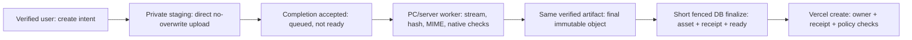

# B16 — Direct upload, worker verification and creation readiness

- Task/owner: B16 / Codex(Backend), Master `msg_f4b770bb88d8`.
- Status: **ready_review — architecture only; no implementation or provider operation**.
- Last checked: **2026-11-17 21:37 KST (12:37 UTC)**; incorporates Master `msg_2f77fcb2afee` and B15-R scope acceptance.
- Sources/configuration checked2026-11-17; actual account plans/buckets/limits were **not** inspected. A personal “Pro” subscription is not evidence of Supabase organization/project billing or Vercel plan.
- Current source baseline inspected `8ffe3c75b5eaa908ee000f574cf688dd65125378`; B14 `ba3ad44`, B15 `1d561c1`. Only this report changes. B15 review files frozen.

## Recommendation and current limitations

**Browser uploads directly to private quarantine Storage. A separate PC/server worker verifies actual bytes and publishes an immutable final object plus durable receipt/asset record. Vercel project creation performs short owner/readiness/receipt queries only.** Do not connect B14's native video/temp/full-download path to a Vercel HTTP creation request. Do not replace verification with a client boolean or bare object metadata.

Current B14 streams to disk, hashes/counts, sniffs/decode-checks images, invokes ffprobe and then removes its scratch artifact. Its total timeout is≤60s and scratch usage can approach the declared file size. B15 runs that verification **while holding asset FOR SHARE inside a PG transaction**, with≤10s signal budget against the existing15s idle-transaction setting. Neither is a practical2GB serverless request contract; tests prove isolated local correctness, not throughput, native-binary deployment or long-file readiness. Cancellation cannot abort already dispatched COMMIT, OS cleanup or all native work at an exact millisecond.

Existing worker/main and jobsService are **SQLite/mock/render** execution, with60s lease,20s heartbeat and attempt checks. They are not a cloud upload verifier or a PostgreSQL job dispatcher. A new isolated storage verification entry point is required; simply adding a new job.kind to the current runner would enter unrelated generation paths. PLAN P7-4's future pg-boss work is separate; this proposal uses a domain intent/lease, not a new general queue framework.

B15-R acceptance is limited to the unconnected trusted-server contract. A real successful COMMIT followed by lost response can produce503 while durable project/stage/link/audit rows remain. Future creation UI/API must classify this as **outcome unknown**, query owner-scoped operation status and reconcile before retry;503 is not evidence that creation failed. Add a separate durable owner+creation-request idempotency/status contract before enabling automatic retries; upload-intent idempotency alone does not deduplicate project creation. A trusted pool can rewrite same-owner SQL and is not sandboxed; an in-flight pg_sleep abort is not a hard deadline. B15's original19/B12 regression20/focused97/independent18 checks overlap and must not be summed as distinct coverage.

## Current primary-source limits and installed SDK

| Source checked | Verified fact / implication |
| --- | --- |
| [Supabase file limits](https://supabase.com/docs/guides/storage/uploads/file-limits) | Free file cap50MB; Pro+ configurable global cap up to500GB. Bucket cap cannot exceed global cap. Existing application maximum is exactly2×1024³ bytes; Free cannot provide that range. Eligible plan and both configured limits must accommodate2,147,483,648 bytes. Do not silently reduce the product limit. |
| [Method limits](https://supabase.com/kb/troubleshooting/upload-file-size-restrictions-Y4wQLT) | Separate upload-method ceilings apply; documented resumable/S3 support up to50GB covers2GB, subject to plan/global/bucket caps. A larger plan cap alone does not override a method cap. |
| [TUS guide](https://supabase.com/docs/guides/storage/uploads/resumable-uploads) | Recommended above6MB; documented6MiB chunks, direct Storage hostname, signed token via x-signature, resumable resource up to24h and first-completion conflict behavior without upsert. Individual signed URLs are not revocable. TUS support does not grant Free a larger size allowance. |
| [Signed upload reference](https://supabase.com/docs/reference/javascript/storage-from-createsigneduploadurl) | Upload capability valid2h without further authentication. Installed SDK2.119.0 accepts path/upsert, not a caller-defined expiration argument. Application intent expiry cannot shorten an issued provider capability by itself. |
| [Vercel function limits](https://vercel.com/docs/functions/limitations) / [runtimes](https://vercel.com/docs/functions/runtimes) |4.5MB HTTP payload limit, finite plan-dependent duration, bounded memory/bundle; writable instance-local scratch up to500MB. A2GB upload/spool exceeds this scratch/body architecture. Streaming alone does not remove finite execution/resource limits. |
| [Storage ownership](https://supabase.com/docs/guides/storage/security/ownership) / [access control](https://supabase.com/docs/guides/storage/security/access-control) | Provider owner_id derives from JWT subject; service-key/dashboard resources may lack it. Ownership alone is not access control; service credentials bypass RLS. App asset owner must come from verified intent/Auth authority, not guessed provider owner or client metadata. |

Installed supabase-js/storage-js **2.119.0** source confirms `createSignedUploadUrl`, `uploadToSignedUrl`, download.asStream; upsert permission is determined at signing, not fixed by a later uploadToSignedUrl option. Actual hostile header/upsert/replay behavior must still be tested against a separately assigned provider test bucket before readiness. No tus-js-client/Uppy entry was found in current package-lock; adding a pinned TUS client requires its own future implementation scope, not an installation here.

The TUS guide has no consulted Pro-only protocol restriction; Free remains bounded50MB. PLAN P7-2 already calls for Storage(Pro,TUS,direct browser upload). Existing project billing/limits are unknown, so neither upgrade nor cost is assumed authorized by an unrelated Pro account.

## Proposed data path

| Phase | Required contract / atomic boundary |
| --- | --- |
| Intent | Verified server actor creates owner-bound intent and reserved UUIDv7 asset ID; explicit bucket, unique unpredictable staging nonce, cap, expected upload properties, policy version, expiry and owner-scoped idempotency key. Client SHA/MIME/size are claims, never verification evidence. Small JSON request only. Persist intent before issuing capability; never accept caller bucket/URL/owner. |
| Signed direct upload | Sign only the intent's private **incoming** path with upsert=false; return narrowly scoped bearer capability to that user, never service key. Configure exact provider-issued TUS endpoint, not an assumed host. Browser data goes to Storage, not Vercel. Bound bucket/global limits and deny user UPDATE/DELETE/rename/copy/move/final-prefix writes. Capability replay/hostile x-upsert must not overwrite an existing upload; require a real negative acceptance test. |
| Completion receipt | Authenticated owner submits intent ID/idempotency key only. Server rechecks owner/state/expiry and atomically marks completion-requested/enqueues domain work once. Client success/webhook/Storage metadata is not “verified”. Respond pending/verification status; do not insert a usable asset yet. Duplicate completion returns the same intent/asset identity, not a second job/asset. |
| Worker claim | Short DB lease claim with server time, monotonically increasing attempt/fence and opaque lease capability/worker principal; heartbeat and conditional renewals. Commit claim before any network/native work. No DB row lock or open transaction during the long download, inspection or upload. Worker loses authority on expiry/cancel/new fence. |
| Verify staging | Read exact bucket/key from authoritative intent. Download full stream to private owned scratch with byte cap/time/cancel, compute actual SHA/size, detect allowed MIME, full image decode/pixel bound or video duration/probe. Compare any client expectations; wrong/corrupt/overlimit fails. Record verifier code/policy/tool versions. No client-controlled ffprobe path, URL or local filename. |
| Publish final | Final key uses actual owner/reserved asset ID/**computed** SHA/canonical detected extension, matching B14 key contract. Upload **from that same verified scratch artifact**, no overwrite. Do not remote-copy a mutable staging key after inspecting earlier bytes. Hash the transmitted stream and independently verify final object bytes before finalization, or prove an equivalently strong provider version/checksum contract; ETag alone is not SHA evidence. A collision is only idempotently accepted after exact identity+bytes proof; never overwrite on conflict. |
| DB finalize | New short transaction rechecks live fence/lease/owner/intent/cancel/expiry/policy, binds final identity and measurements, inserts immutable verification run/receipt, registers existing-format asset and sets ready companion state plus audit/outbox. Commit together, using actual measured metadata. No finalization by late/dead worker or browser. If external publish succeeded but DB commit is uncertain, reconcile by intent/final identity before retry/cleanup. |
| Vercel create | Join actor-owned nonarchived asset to current unrevoked ready state and immutable receipt with matching asset/bucket/key/SHA/size/MIME/policy epoch/validity. Use short locks only on asset/ready state during existing project/stage/link/audit transaction. **No stream, scratch, Sharp, ffprobe, worker wait or metadata-only Storage fallback.** Missing/expired/revoked/forged evidence fails closed. Current B15 default is not changed by this design. |

Separate quarantine and final namespaces/buckets are required; only staging gets user upload capabilities. A browser must never receive a token authorizing the canonical final key. Provider storage.objects.owner_id may be null/service identity rather than the app user; key/intent authorization plus measured final registration is explicit. Preserve existing assets.owner_id→auth.users FK and actual DB owner checks.

## What a trusted receipt proves — and does not prove

Receipt is append-only trusted worker attestation, **not `verified=true` supplied by the client**. Bind at least owner/intent/asset IDs; source bucket/key and observed source identity; final bucket/canonical key and provider version if genuinely supported; exact measured byte SHA/size/MIME/kind/dimensions/duration; policy ID/digest, verifier source/tool version, worker principal, attempt/fence, completion time and expiry. Store canonical receipt digest and issuance provenance. Only the restricted finalize path may issue it; web runtime/user roles cannot insert, edit, replace or self-approve it. Worker compromise is a trust failure; a digest is not remote/hardware attestation that ffprobe ran.

Lightweight acceptance is justified **only while** final write/delete/copy/overwrite authorities are constrained and all supported lifecycle changes invalidate readiness first. Canonical hash naming does not itself prevent overwrite. SDK versionId support does not prove hosted immutable versions/Object Lock; none was verified. Do not market ordinary private buckets as WORM.

Every registration tuple must exactly equal its receipt; checks run under actor RLS and companion-state lock, not an untrusted cached browser receipt. Policy epochs permit server-side revocation/reverification. Receipt not_after is explicit and policy-controlled: expiry blocks **new reference admission**, queues revalidation and never rewrites history. Final timeout/retention policy values require later operational sizing; a suggested short application-intent lifetime is not a signed-capability lifetime.

Point-in-time verification/HEAD cannot prove future bytes. Arbitrary provider admin/service-role deletion after the transaction is not preventable by this DB receipt. If such authority is exercised outside the controlled lifecycle, mark affected receipt unavailable/revoked and reconcile/reverify; until detected, availability can be stale. Downstream use still needs its own identity/hash safety. Security equivalence to full per-use hashing is not claimed against a privileged adversary or unknown mutation path. Lack of enforceable final mutation authority is a **readiness blocker**, not justification for a bare ready flag.

## Lifetime, cancellation, races and compensation

| Situation | Required outcome |
| --- | --- |
| App intent expires/cancels | Stop further app acceptance/finalization; signal worker. Already issued signed capability may still write staging. Do not claim immediate token revocation or rotate a whole project's signing key to cancel one file. Late bytes remain quarantined, unusable. |
| Provider token / TUS expiry | Track every capability issue/reissue and latest expiry without logging its token.2h signing and up-to24h resource lifetimes are distinct. Conservative cleanup must allow latest token expiry plus possible resource lifetime and grace until provider semantics are tested; not simply app expiry. A repeated token mint must not silently extend an abandoned intent indefinitely. |
| Concurrent completion/TUS uploads | Owner+intent completion key unique; one domain work identity. First successful no-overwrite object wins; others conflict or reconcile, never last-writer-wins. Same idempotency key with a different tuple is a conflict. |
| Worker retry/lease theft | New fence supersedes old; old heartbeat/finalize/ready publication rejected. Every finalizer checks fence atomically, even after hours of IO. Retry only transient failures with bounded backoff/attempt budget. Deterministic invalid bytes fail terminally unless user creates a new upload intent. |
| Cancel during publish | Upload may finish externally, but late worker cannot register ready. Record/reconcile orphan final object with its exact identity; no silent selection or existing-asset mutation. |
| Object created, DB failure/unknown commit | Persist/recover outbox/reconciliation identity. First query final receipt/intent; a committed asset must never be deleted as an assumed orphan. Retry exact tuple idempotently; conflicting contents are incident/failure, not overwrite. |
| Cleanup failure | Durable owner/intent/object-scoped outbox, retries, safe errors and operator evidence. Delete only exact unregistered staging/promoted-orphan objects after capability grace and reference/state checks. Do not edit provider storage tables directly. |
| Registered original later archived/revoked/deleted externally | Existing original-file/history preservation still applies. No automatic deletion of registered originals, asset rows, previous receipts or project references. Mark availability revoked/unavailable; restoration from trusted bytes needs separately assigned recovery. Do not “repair” by unrestricted overwrite. |
| GC versus create | Creation holds ready-state SHARE for its short transaction; supported revocation/GC locks state exclusively, revokes before external deletion. GC must recheck registration/links/history; ready/used originals are not orphan cleanup candidates. Privileged unsupported deletion remains the explicit trust limitation above. |
| Worker offline/policy expired | Show queued/unavailable according to later adapter contract; new create admission fails closed. No heavy Vercel retry or always-true callback. Existing historical records remain unchanged. |

Worker scratch is private/OS-trusted, with explicit byte/disk/concurrency bounds and no user path or root mutation authority. B14's accepted junction limitation remains: cleanup-boundary refusal is not a complete sandbox against a local principal controlling privateRoot. A future worker must retain a scoped verified artifact through promotion rather than use today's B14 verify result after its file has been removed. Worker budgets for2GB need measured network/native/disk sizing; cannot merely increase B15's10s or pretend B14's60s is sufficient.

## Minimal roles and append-only schema proposal

Current assets has immutable file tuple/kind, owner FK, MIME/size/SHA/dimensions/duration/origin/archive fields but **no intent, verification state, receipt, lease or expiry**. Do not overload rights_note/is_mock or mutable JSON settings as a security receipt. New companion state is required. Existing dream_worker is cross-owner SELECT/INSERT/UPDATE across18 business tables; it is not a new least-privilege upload-verifier credential.

Proposed new tables (names provisional, no DDL written):

| Table | Essential contract |
| --- | --- |
| upload_intents | Owner+reserved asset identity, immutable incoming target/nonce/declared limits/policy, idempotency key, capability lifetime accounting, state/cancel, lease owner/fence/until. Owner+idempotency unique. Only bounded functions advance mutable lifecycle. |
| asset_verification_runs | Append attempt/fence, observations/result/source-final measurements/error codes and verifier/policy identity, including failures. No client writing or historical edits. |
| asset_verification_receipts | Immutable successful proof tuple; owner+asset and intent bindings, receipt digest/version/time/not_after; exact final identity uniqueness; owner-composite FK to existing asset. |
| asset_receipt_state | One owner+asset current receipt and ready/revoked/unavailable status/reason/epoch, referencing immutable proof. Controlled update/locking for create versus revocation. |
| storage_outbox | Durable publication/cleanup/reconciliation obligations with exact owner/object/intent identities, attempt/fence/idempotency and success evidence. No public URL/token payload or arbitrary deletion prefix. |

Browser/UserJWT: only owner-bound live incoming INSERT capability; no final mutation, receipt writes or general listing. Vercel issuer should use verified user-scoped Storage authorization/RLS where possible, not distribute service key. Finalizer/verifier DB login: no general business DDL, no role management, no inherited dream_worker/dream_api parent; EXECUTE only bounded claim/heartbeat/finalize procedures and required own job reads. A NOLOGIN registrar can own tightly scoped security-definer functions with fixed search_path, PUBLIC EXECUTE revoked, checked intent/fence/owner and only needed asset insertion/helper rights. Do not forget the existing FORCE RLS: a new role does not gain insertion merely from table INSERT grant; an explicit narrowly scoped registrar policy is required.

Storage worker/promoter credentials must separately enforce SELECT incoming/INSERT final without UPDATE/DELETE; cleanup uses distinct authority. Hosted custom-role/RLS capability and signed-token malicious upsert enforcement need actual acceptance tests. If only broad service-role is used for an interim trusted worker, call it **privileged trusted-server operation**, not RLS-enforced least privilege or immutable-storage readiness. No automatic broad-key fallback or new credential was made here.

### New migration choices and runner impact

**Recommended:** a newly reviewed append migration (e.g. proposed `0004_storage_verification.sql`) and explicitly versioned manifest/upgrade runner supporting known SQL3→SQL4. Preserve published SQL3 bytes/checksums and old history rows. Add companion tables/policies/functions/roles/immutability and explicit asset registrar RLS support; keep existing assets columns/owner FK and original histories unchanged. Audit exact new policy/role graph and revoke unnecessary public grants.

Current B5 runner accepts fresh/complete **three-entry** history and fixed18tables/36policies/18guards; it is not an incremental3→4 engine. A new asset registration policy/tables will invalidate those expectations. Future work must version expected counts/manifest, lock/validate the same approved target and test existing3-state upgrade/unknown-state refusal/rollback/idempotency. Never loosen old checks ad hoc or edit history to pretend SQL4 was already accepted. Reserved-role graph must not acquire new parents/inbound runtime grants.

An alternative separate storage namespace/history can isolate new tables, but **does not eliminate** the registrar asset-policy/ACL and migration compatibility problem. It still needs an explicit coordinated/versioned migration contract. Reusing old broad worker privileges merely to avoid SQL evolution is not the least-privilege recommendation. No new schema can be applied with the currently accepted v1 runner without a separately assigned change/review.

## Proposed staged files / completion gates — no work started

| Stage | Candidate exact paths / completion gate |
| --- | --- |
| Protocol/schema design and offline migrations | `lib/storage/uploads/{schema,state,receipt}.ts`; proposed `lib/db/postgres/0004_storage_verification.sql`, versioned migration manifest/runner files, `tests/postgres/storage-verification-migration*.test.ts`. Gate: existing3 upgrade/new install/unknown-state/ACL+FORCE-RLS/role graph/rollback/source hashes independently pass. Package/SQL scope must be explicitly assigned. |
| Intent/completion domain server | `lib/repo/postgres/upload-intents.ts`, `lib/services/postgres/upload-intents.ts`, `tests/postgres/upload-intents*.test.ts`. Gate: verified owner, cap, lifetime, concurrent completion/idempotency/cancel, forged finalization refusal. No actual API needed initially. |
| Worker byte verification/publication | `worker/storage-verify.ts`, `lib/storage/worker/{verify-artifact,promote}.ts`, `lib/repo/postgres/asset-verification.ts`, `tests/storage-worker*.test.ts`. Gate: same-artifact promotion/hash, lease fencing,2GB streaming resource budget, media failures, lost commit/orphans/cancel/outbox, no long DB tx. Do not modify existing worker/main mock dispatcher without separate scope. |
| Vercel lightweight admission | `lib/services/postgres/asset-receipt-availability.ts`, narrow repo readiness query and future explicitly assigned create composition. Gate: forged/stale/revoked/wrong owner/tuple/policy receipts denied; create/revoke race atomic; no fs/native/worker imports in Vercel route bundle; old B12/B15 regressions preserved. Not a default callback change now. |
| Browser/TUS and operational integration | Later explicit `components/uploads/private-upload.tsx`, intent/complete/status routes, pinned TUS client/package changes and private bucket/RLS configuration. Gate: real authorized provider sandbox cap/token/upsert/expiry/RLS tests, actual worker credentials/tools/private disk/monitoring, resource/cost acceptance, independent end-to-end review before write opening. No live target inferred as staging. |

## Required future matrix

| Area | Evidence required |
| --- | --- |
| Caps/provider | Boundary sizes exact app2GiB, app+1 rejected; Free50MB truthful refusal; eligible plan global/bucket caps verified. TUS multi-chunk resume, token2h/resource lifetime, replay/hostile upsert/cross-owner/cross-key/expired-intent real provider tests; no Vercel large-body proxy. |
| Worker | Actual PNG/video corruption, MIME/hash/size mismatch,2GB incremental IO/disk pressure, interrupted network/native process, concurrent jobs/OS private root, artifact mutation and promotion from same bytes; final object re-verification. No full-file buffer or hidden temp cleanup races. |
| Fencing/idempotency | Concurrent complete, two workers, heartbeat loss/reclaim, stale attempt after final upload, cancel each phase, duplicate finalize and lost DB commit responses; exactly one registered identity/receipt or quarantined orphan, never false ready. |
| Authority/receipt | User cannot issue/alter receipt; service-role boundary acknowledged; registrar FORCE-RLS policy correctness; owner FK preserved, missing/null/corrupt tuple and forged worker rejected; policy revocation/expiry prevents new admission. DB digest alone is not proof of a trusted executor. |
| Lifecycle | Mutation/deletion attempts denied for every ordinary principal; revoke-before-delete races; admin bypass incident/reconciliation; cleanup fails/retries without deleting committed originals, new owner object or historical refs. |
| Vercel/create | Fast DB-only owner+ready admission and B4 read compatibility; no Sharp/ffprobe/temp/fullstream in HTTP trace; worker offline pending failure, create/audit rollback, no default validation weakening. Inject committed-but-response-lost503: owner-scoped status recovers the durable result, same creation request returns the same project, conflicting replay fails; no blind duplicate creation. |

## Costs / actual human decisions

[Current Supabase pricing](https://supabase.com/pricing) lists Pro from$25/month before applicable extra usage; actual organization/compute/usage total must be checked before committing cost. If the actual project is Free, satisfying unchanged2GB capability requires an eligible plan/settings decision. If already eligible, no duplicate subscription or automatic upgrade is warranted. This is not an approval request or purchase now.

Additional usage: quarantine+final may transiently store roughly4GiB for one2GiB accepted original; staging read+independent final read can transfer roughly4GiB to worker, plus upload traffic and retries. Exact billed egress/storage depends on region/plan/cache/provider metering, not assumed. Worker needs private disk≥file+reserve, bandwidth, uptime/CPU/tool support; existing PC may suffice but was not capacity-tested. No paid resource, new network service or always-on agent was installed.

Master can resolve technical naming, isolated stages, tests and explicit configuration under existing authority. Actual user decisions are needed only if confirmed facts require new paid plan/ongoing resources or a materially new retention/availability/cost commitment beyond existing approval. Gather actual project plan/caps/worker capacity first; do not ask the user to approve a speculative subscription or every technical step. Production SSL/restart remains its separate existing decision.

## Delivery boundary

This document is a proposed contract, not implemented receipt/schema/worker/API support. No bucket/policy/DDL/DB registration/upload/worker execution/configuration/managed access/deployment occurred. Published SQL3/history/assets columns/owner FK unchanged. No tests were run for prose-only design; installed sources/current primary references were read. B14/B15 local proofs remain bounded to their recorded scopes.

Transfer: **B16 ready_review. Recommend signed private incoming upload→completion pending→fenced PC/server byte/native validation→same-artifact no-overwrite final publication→atomic trusted receipt+asset ready→Vercel DB-only owner/receipt admission.2GB cannot fit Free50MB or Vercel500MB scratch/4.5MB payload; actual plans unknown. Token2h/TUS24h/cancel/orphan lifetimes, immutable-permission versus point-in-time proof, minimal registrar FORCE-RLS/new append-manifest needs, lease/idempotency/revocation/compensation, exact staged paths/matrix/cost conditions documented. No current validation/default/API/SQL/worker/real resource change.**
