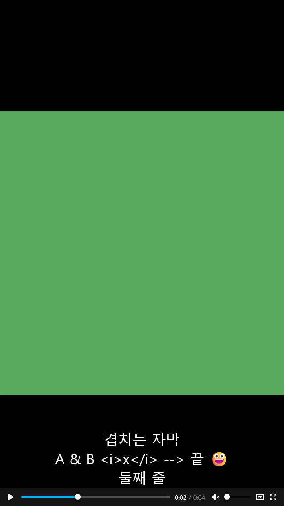

# Firefox의 실제 내보내기 WebVTT 재생

고정 s9 백업의 합성 사본에 T157 검수용 자막 두 개를 저장했다. 제품 검수·내보내기 경로에서 생성한 ZIP의 SHA-256은 7c19cf47ba3e2b822b8cd6ffb7fdca5e0f784f5768ffcf293c080d87134895b1이다. ZIP에서 추출한 subtitles/timeline.vtt는 이전 T157 검수 바이트와 일치했다. VTT SHA-256은 1b5cc7ca8433cac691eea49e5bae66c40ad252e21d1e2ea5ef246c74addc68ef다.

Windows에서 Playwright 1.65.1의 Firefox 159.0이 네이티브 video/track으로 4초 WebM과 제품이 만든 4초 H.264/AAC MP4를 재생했다. 두 파일에 같은 VTT를 적용했다. 자막 두 개의 ID가 저장 레이어와 같았고, 30fps 프레임 경계 대비 최대 시간 오차는 0.333ms였다. 한글, 줄바꿈, 이모지와 리터럴 HTML 모양 문구가 원문 그대로 표시됐다.

0.1→0.5→1.5→2.7→3.5→1.5초 탐색의 활성 자막 수는 모두 0→1→2→1→0→2였다. 아래는 MP4를 1.5초로 다시 이동한 실제 브라우저 화면이다.

내보내기·자막 측정 관련 테스트 19건 통과. 로컬 실행 자료는 D:/starwork/p2-firefox-vtt에 있다. Safari와 휴대폰 재생은 별도 확인 대상이다. [Playwright 브라우저 환경](https://playwright.dev/docs/browsers) · [Chromium의 이전 검수](T-157-VTT-REVIEW.md)

> 플래너 전달문 — 실제 편집용 ZIP에서 추출한 VTT를 Firefox 159에서 WebM과 H.264/AAC MP4에 연결했습니다. 두 자막의 원문과 경계, 겹침을 포함한 탐색 6회가 일치했고 최대 경계 오차는 0.333ms였습니다.
