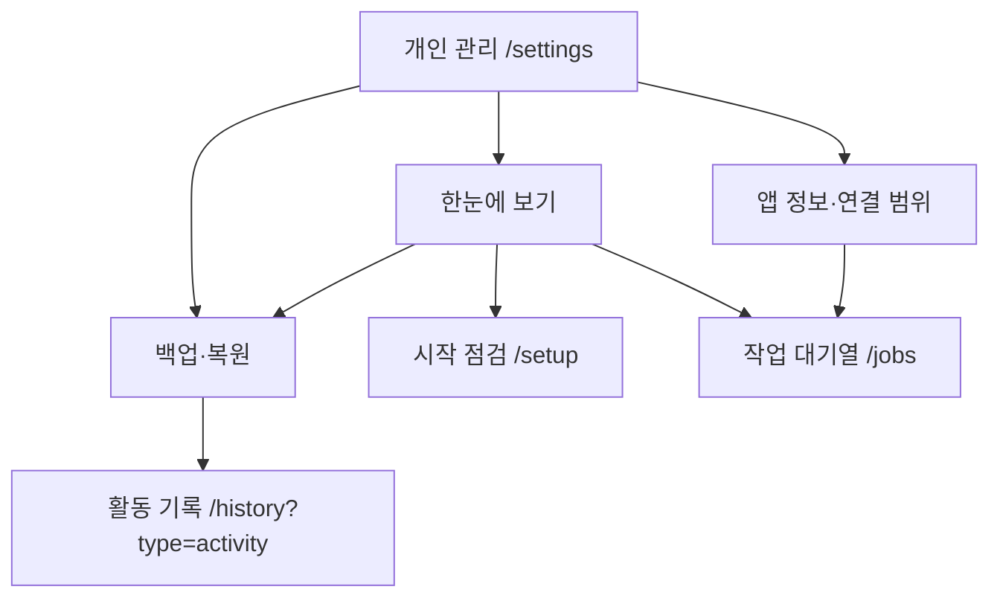

# T180 · 개인 관리 UI 설계·구현 계획

| 항목 | 내용 |
|---|---|
| 담당 | Codex(design) · CX-DESIGN-01 |
| 배정 / 범위 확정 | Master `msg_2248a60c3503` 관리자 UI 계획 → `msg_3d1ceb717ade` **개인 관리부터** |
| 수신 | `msg_89928f293467` |
| 기준 | `57e3eb9` / 현재 제품 `695e69b` 및 기존 설정·점검·작업·기록 코드, DESIGN v1.4 |
| 상태 | **ready_review · 구현 배정 가능한 설계안**. UI 구현·배포·실행 검수 결과가 아님 |
| 변경 | 이 고유 보고서만. 제품/공유 문서/사용자DB/3013/공유 .next/도구는 변경하지 않음 |

## 1. 목적과 첫 범위

개인 사용자가 **지금 작업을 진행할 수 있는지, 작업 처리기가 응답하는지, 내 자료의 마지막 백업이 어떤 상태인지** 한곳에서 확인하고 필요한 화면으로 바로 이동하게 한다. 별도 관리자 계정이나 권한을 만드는 작업은 아니다. 현재 개인 로컬 앱에 맞춰 시작한다.

첫 화면 이름은 **개인 관리**, 기존 `/settings`를 유지한다. 주 메뉴의 “설정”을 “개인 관리”로 바꾸는 안을 추천한다. 기존 작업 대기열(`/jobs`), 시작 점검(`/setup`), 생성·활동 기록(`/history`)은 상세 화면으로 재사용한다. 새 `/admin` 셸이나 중복 관리용 작업표를 만들지 않는다. 링크/북마크·백업/복원 API도 유지한다.

현재 운영은 **T178 보고상** 695e69b의 next start3013·worker·실제DB 단계10으로 전환됐다. 이번에 라이브를 다시 읽거나 확인한 것은 아니다. 따라서 이 계획의 화면 숫자·상태 예시는 **예시**이며 현재 사용자의 실제 상태라고 표시하지 않는다.

**1차 구현에 포함:** 개인 관리 개요, 기존 백업/새 폴더 복원 흐름의 정보 정리, 기존 상세 화면 연결, 읽기 상태/오류/모바일/키보드 처리. **후속:** 수동 도구 진단의 별도 읽기 계약. 실제 AI 연결·비용/예산은 기존 P3 범위 그대로다. 사용자/권한 관리·원격 공개·서버/worker 재시작·전체 작업 일괄 조작·자료 청소/초기화·현재 DB 덮어쓰기·자동 업데이트를 추가하지 않는다.

## 2. 정보 구조와 진입



- 상단 제목: **개인 관리**. 설명: “내 PC의 작업 상태와 백업을 확인해요.” 샘플 모드 배지는 기존 값으로 표시.
- 페이지 안 이동: `#overview`, `#backup`, `#restore`, `#app-info`의 일반 anchor 목록. 모든 영역을 같은 페이지에 유지하며, 숨겨졌다 다시 그려지는 tab panel로 바꾸지 않는다. 복원 ticket·입력·진행 중 요청을 잃지 않기 위해서다.
- 각 개요 카드의 행동은 **상세 화면으로 가는 링크**다. “처리기 켜기/자동 복구” 같은 실행 버튼은 현재 지원하지 않는다. 지금 백업·위치 저장·복원은 아래 원래 폼에서만 실행한다.
- 경고가 있으면 “먼저 확인할 것”을 제목 다음에 보이고 해당 카드/점검 링크를 제공한다. 없으면 이 영역은 숨긴다. 같은 문제를 카드와 banner에서 긴 문장으로 반복하지 않는다.

## 3. 화면 배치 초안

1280: 기존 남색 sidebar/상단바와 본문 폭·토큰을 유지한다. 내용이 들어가는 공간에 개요3칸을 놓고, 아래 폼은 한 줄 전체를 쓴다. 기존 T125 시안 선택이나 전체 앱 셸 변경을 포함하지 않는다.

```text
개인 관리                                    샘플 모드
내 PC의 작업 상태와 백업을 확인해요.
[먼저 확인할 것: 실제 확인된 문제 · 해당 화면으로 →]  ← 있을 때만

한눈에 보기 | 백업 | 새 폴더 복원 | 앱 정보             ← 페이지 안 이동

┌ 저장 점검 ─────────┐ ┌ 작업 처리기 ────────┐ ┌ 이 환경의 백업 ───────┐
│ 통과/확인 필요/실패 │ │ 최근 응답 있음/없음 │ │ 마지막 성공 시각/없음 │
│ 점검 결과의 한 문장 │ │ 작업 대기열 보기 →  │ │ 파일 확인 필요 여부   │
│ 시작 점검 보기 →    │ │                    │ │ 백업 관리로 →        │
└────────────────────┘ └────────────────────┘ └───────────────────────┘

백업
마지막 성공·실패 / 처리기 응답 / 자동 백업 조건
백업 저장 폴더 [실제 입력값 …………………………]
[백업 위치 저장] [지금 백업] [상태 새로고침]
백업 이력: 시각 · 수동/자동 · 출처 · 생성/검증 이력 · 파일 존재

새 폴더로 복원
기존 백업 선택 → 목적지 입력 → 검사 → 검사 결과 → 새 폴더에 복원

앱 정보·연결 범위
기존 앱/템플릿 정보 · 샘플 작업 범위 · 실제 AI/예산은 P3 안내
```

390: 같은 DOM/읽기 순서로 제목→문제→페이지 안 이동→점검→처리기→백업 카드→백업 폼→복원→앱 정보로 한 칸씩 놓는다. 카드를 carousel로 숨기지 않는다. 페이지 안 링크는 줄바꿈하고 가로 넘침을 만들지 않는다. 폴더 경로·날짜·긴 오류는 줄바꿈한다. 주 행동48px, 그 외 누르는 곳44px 이상이다.

백업 이력은 PC에서도 핵심 정보가 긴 table보다 기존 카드 목록을 유지한다. 모바일에서 과거 환경·파일 없음·복원으로 멈춤의 이유를 생략하지 않는다. 기본 노출은 최근 기록 중심으로 정리하되, **서버가 반환한 전체 목록을 몰래 잘라 버리지 않고** “더 보기”로 같은 자료를 펼친다. 페이지 나누기/서버 검색은 별도 계약 전 추가하지 않는다.

## 4. 카드의 정확한 뜻과 데이터 계약

| 카드·본문 | 이미 있는 근거 | UI 표시와 제한 |
|---|---|---|
| 저장 점검 | `checkStartup(): {checks,canStart}`, 각 check id/label/status/message/detail/code | pass만 정상색. warning은 확인 필요. fail은 실패+해결 경로. **canStart=true는 앱 전체/영상·청취 품질 검증 완료가 아님**. 제목을 “전체 시스템 정상”으로 쓰지 않음 |
| 작업 처리기 | 기존 `listJobs().workerOnline`, GET `/api/backups`에도 workerOnline 포함 | true: “최근 응답 있음”. false: “최근 응답을 확인하지 못했어요.” heartbeat45초 기준이며 프로세스 종료 판정으로 확대하지 않음. 링크는 `/jobs` |
| 이 환경의 백업 | `BackupsData.lastSuccess/lastFailure`, rows의 origin/inherited/originUnconfirmed/available/verifiedAt | **local 집계값 그대로** 사용. 이전 환경 백업을 현재 환경의 마지막 성공으로 대체하지 않음. 성공 이력+available=false는 “파일 확인 필요”를 함께 표시 |
| 자동 백업 | 기존 동작: 처리기가 켜져 있을 때 하루1회, 다음 실행 시 놓친 백업 처리 | “처리기가 켜져 있을 때 하루 한 번 실행해요.” 다음 시각·완료 예정시간·상시 실행을 추측하지 않음 |
| 백업 위치 | `readBackupConfiguration().directory` 및 기존 PATCH | overview에 전체 PC 경로를 펼쳐 나열하지 않음. 폼에서 위치를 확인/변경할 때 기존 전체 경로 사용. “위치 저장”과 “백업 성공”을 분리 |
| 복원 | 기존 inspect/finish DTO와 ticketStatus/retryable | 같은/업그레이드 구조, 파일/프로젝트/자료/진행작업 수, 만료·목적지 그대로. 검사 통과와 복원 완료는 별개 |
| 앱 정보 | 현재 앱0.1.0 표시·config.templateVersion·sampleMode | 실제 현재 값만. 배포SHA/데이터 구조/FFmpeg 설치/연결 계정을 검증했다고 만들지 않음. MOCK_MODE=false는 현재 “생성 잠김”이며 실제 AI 연결 성공이 아님 |
| 활동 기록 | `/history?type=activity`, 기존 type/page/projectId 계약 | 변경 기록으로 연결. 관리 변경을 숨기거나 관리자 이름/별도 감사 로그를 새로 꾸미지 않음 |

**1차에서 새 backend endpoint는 필요하지 않다.** Settings page에서 이미 하는 checkStartup 결과를 버리지 않고 한 번 읽어 요약 prop으로 넘기는 최소 변경을 제안한다. 백업/처리기 요약은 SettingsPanel의 현재 `data`에서 파생한다. 같은 백업 상태를 별도 server/client store 두 개에 저장하지 않는다.

구현 제안(아직 없는 새 prop): `startupSummary: {checks: StartupCheck[],canStart:boolean,checkedAt:string}`. checkedAt은 **이 점검을 실제 읽은 시각**이고 현재 프로세스가 살아 있다는 시각이 아니다. 앱/템플릿·sampleMode는 기존 값 전달. 백업 카드의 마지막 갱신은 기존 GET 성공 시각을 별도로 관리한다. 서로 다른 시점의 자료를 하나의 원자적 전체 상태라고 말하지 않는다.

checkStartup은 폴더 쓰기 probe를 만드는 **실제 점검**이며 순수 메모리 조회가 아니다. 이를2초마다 신규로 실행하는 관리자 polling을 추가하지 않는다. 점검 다시 읽기는 page refresh의 명시적 동작으로 한다. 백업이 queued/running일 때의 기존2초 갱신만 유지한다. 갱신 실패는 이전 자료+그 자료 시각을 남기고 “새 상태를 읽지 못했어요”를 표시한다.

현재 settings page는 시작 점검 실패 시 DB 읽기를 건너뛰고 `/setup` 안내를 보여 준다. 이 경계를 유지한다. DB가 읽히지 않는데 백업0개/작업0개/정상으로 채우지 않는다. 관리자 overview를 보여 주려고 이 조건을 우회하지 않는다.

## 5. 운영 흐름과 상태별 표현

### 평소 확인

개인 관리 진입 → 점검·처리기·이 환경 백업 확인 → 필요할 때 백업 폼/작업 대기열로 이동. 문제가 없으면 강한 경고·큰 진단 숫자 없이 짧게 끝난다. 현재 JobsData의 실패 목록에는 과거 실패도 남으므로 이를 “미해결 장애N개”로 합산하지 않는다. 첫 버전의 처리기 카드에는 불완전한 장애 숫자를 추가하지 않는다.

### 백업 위치 변경과 지금 백업

입력 변경은 초안이다 → 위치 저장 성공 시 **“백업 위치만 저장했어요.”** → 지금 백업은 POST202 뒤 **“백업을 대기열에 등록했어요. 검증이 끝나야 완료예요.”** → queued/running/succeeded/failed는 실제 응답으로 바뀐다. worker 응답이 없을 때도 기존 queue 요청 계약을 유지하고, 처리기가 켜지면 시작한다는 이유를 표시한다. 요청을 곧바로 성공 카드로 바꾸지 않는다.

“지금 백업”은 폼 안 한 곳에만 있다. 개요 카드에는 폼으로 가는 링크만 둔다. 중복 요청 방지·working/busy 제한을 원래대로 유지한다. 폴더를 입력 중에 자동 갱신돼도 입력을 서버의 예전 값으로 덮지 않는다.

### 새 폴더 복원

기존 **백업 선택→새 빈 폴더→검사하기→결과 확인→새 폴더에 복원**을 그대로 사용한다. 현 데이터 교체는 만들지 않는다. 검수 통과 전에 복원 버튼이 생기지 않고, ticket이 있을 때 선택/목적지를 고정한다. 만료/비재시도 실패는 서버 상태에 따라 ticket을 버리고 재검사로, 결과 불명/재시도 가능이면 **같은 검사**를 유지한다. sessionStorage 복구·완료 목적지·실제 retryable 판정을 보존한다.

추가 “관리자 승인”이나 반복 확인 dialog는 넣지 않는다. 기존 검사 결과와 최종 버튼이 사용자가 검토할 구체적인 확인 단계다. 완료 뒤 “지금 데이터는 그대로예요”, 복원본 위치·여는 방법을 유지한다. 과거 환경 백업의 존재만으로 지금 복원 가능하다고 만들지 않는다.

| 상태 | 사용자 문구/행동 |
|---|---|
| 최초 읽기 | 자리 크기를 유지한 읽는 중. 숫자/통과 배지 미표시 |
| 시작 점검 fail | “시작 점검이 필요해요.” + 점검 보기. DB 의존 폼/자료를 거짓으로 제공하지 않음 |
| 점검 warning | 원래 message와 다음 행동. 작업 가능 여부는 canStart와 실제 서버판정 |
| workerOnline=false | “최근 응답을 확인하지 못했어요.” + 작업 대기열. 켜기/재시작은 제공하지 않음 |
| 현재 환경 백업 없음 | “이 환경에서 완료한 백업이 아직 없어요.” 기존 폼에서 첫 백업 요청 가능 |
| 이전 환경/출처 미확인만 있음 | 각각 출처 배지. 이 환경 성공·실패와 분리 |
| 성공 이력, 파일 없음 | 성공 이력을 지우지 않고 “이 PC에 파일 없음”. available을 현재 hash검증 PASS로 쓰지 않음 |
| queued/running | 현재 실제 상태, 중복 백업 이유. 가짜 완료 퍼센트/예상시간 없음 |
| 저장/백업/복원 실패 | 요청별 reason+다음 행동. 코드 작은 글자. 입력과 사용할 수 있는 ticket 유지 |
| 일부 새로 읽기 실패 | 마지막 자료·시각 유지, 실패 영역만 안내. 빈 상태와 구별 |
| 실제 AI 기능 | 샘플/생성 잠김 사실과 P3 안내. API key 입력칸이나 연결 성공 상태를 만들지 않음 |

## 6. 반응형·접근성·입력 상태

- 카드 순서는 점검→처리기→백업으로 고정한다. polling 때 경고 순위에 따라 DOM을 뒤섞거나 사용자 초점을 빼앗지 않는다. 경고가 생기면 상단 요약 내용만 갱신한다.
- 기존 토큰/StatusPill/Icon/Button/Card/Callout 사용. 상태를 색만으로 표현하지 않는다. 주 행동48px, 링크·보조 버튼·summary 최소44px. 1280/390 가로 넘침0.
- 페이지 안 이동은 일반 링크, 실제 이동은 Link, 실행은 Button이다. 일반 anchor 목록에 tablist 역할을 붙이지 않는다. 현재 위치는 aria-current location을 쓸 수 있다.
- form label/도움말/오류를 연결한다. T177 공통 Button의 disabledReason→aria-describedby 계약을 그대로 사용한다. 막힌 버튼 옆에 이유와 갈 곳을 제공한다.
- 읽기 성공마다 Toast를 띄우지 않는다. 명시적 저장·요청 결과는 기존 알림, 실패는 해당 폼의 alert. 복원 ticket 만료 뒤 검사 버튼 초점·같은 검사 재시도 초점 흐름은 유지한다.
- 한 페이지를 여러 tab으로 쪼개 SettingsPanel을 unmount하거나 revision key로 재생성하지 않는다. 폴더 초안·복원 ticket·완료 위치·진행 중 request state가 사라지지 않아야 한다.
- 관리자 UI라는 이유로 원본 입력 본문·API key·환경 변수·전체 로그를 보여 주지 않는다. 필요한 백업/복원 경로는 해당 폼과 결과에서 기존 방식으로 제공한다. 복사할 진단은 명시적으로 선택한 작은 요약만 후속 설계한다.

## 7. 1차 구현 분할과 파일 경계 제안

| 순서 | 구현할 것 | 제안 파일 / 완료 조건 |
|---|---|---|
| A1 데이터·문구 확정 | 위3카드·startupSummary prop·업데이트 시각의 소유자 확정 | `app/(studio)/settings/page.tsx`의 기존 읽기 최소 연결. 서비스/DB/새 API 없이 실제 DTO로 구현 가능한지 확인 |
| A2 개인 관리 개요 | 제목/페이지 안 이동/3카드/문제 요약, 기존 백업·복원 폼 유지 | `components/settings-panel.tsx`, 새 전용 overview component/CSS 또는 전용 module.css. 기존 interactive state·ticket 로직은 리팩터링하지 않음 |
| A3 기존 진입 연결 | 설정→개인 관리 label·breadcrumb, 백업/작업/활동 링크와 영역 id | `components/studio-shell.tsx`, settings page. `/settings` route 유지. 전체 메뉴/워크플로/셸 시안 변경 없음 |
| A4 가짜 DB 자체검증 | 아래 V1~V9 + 관련 settings/restore/jobs/disabled-reason 회귀 | 새 고유 personal-management UI test와 고유 반환 보고서. 사용자DB/운영3013/공유 .next를 쓰지 않음 |
| A5 별도 검수 | 실제 read/action/복원 ticket/390/키보드·오인 상태 대조 | 다른 담당의 독립 검수. 결과 후 Master 통합·배포 판단 |

담당1명/허용파일은 Master가 구현 배정 때 확정한다. 이 문서는 파일 점유나 제품 수정 허가를 새로 취득한 것이 아니다. 폼 전체 분리·새 공용 상태관리·서비스 통합 DTO·마이그레이션이 필요해지면 A2에 몰아넣지 말고 별도 좁은 작업으로 나눈다.

## 8. 완료·검수 행렬

| ID | 직접 확인할 것 |
|---|---|
| V1 | 실제 가짜 DB 정상/점검 fail/warning/읽기 실패. canStart가 worker/백업/렌더 품질을 뜻하지 않음. 실패를0/정상으로 채우지 않음 |
| V2 | worker heartbeat 있음/45초 밖/GET 실패, 처리기 시작·재시작 버튼 없음. queued backup 요청의 기존 동작 |
| V3 | 이 환경 성공/실패·이전 환경·출처 미확인·성공파일없음. 올바른 lastSuccess/Failure와 실제 검증이력/현재존재 구분 |
| V4 | 위치 초안→저장만→지금백업 queued→실제 성공/실패. 새로 읽기/화면이동에도 초안 덮기·중복 요청·가짜 성공 없음 |
| V5 | 실제 inspect→finish, 같은/upgrade 백업, 만료·실패·결과불명 재시도, 세션 ticket 복구와 완료 위치. 원본/현재 DB 불변 |
| V6 | 전체 주 메뉴/기존 `/settings` bookmark/`/jobs`/`/setup`/`/history?type=activity` 연결. 승인 게이트/최종내보내기/모드 동작 불변 |
| V7 | 1280/390 overflow0·44px/주48px·긴 경로/오류/날짜·한페이지 영역순서. keyboard Tab/Enter/Shift+Tab·anchor·오류/티켓 초점 |
| V8 | 명시적 갱신과 queued/running polling에서 마지막 자료시각·실패영역·폼값 유지. DB check probe의 새 고빈도 실행 없음 |
| V9 | 실제 AI/키/예산/도구 진단/배포SHA 미구현을 연결성공·0원·정상으로 표시하지 않음. native phone/screenreader 미실행이면 미확인 |

관련 lint/typecheck/시험/운영 build는 구현 사본에서 실행한다. 운영 빌드는 물리 도구 사본과 외부 runtime을 포함한 현재 T169/T170 추적 검증을 유지한다. 3013은 T178 이후 next start이므로 공유 `.next`에서 build/dev를 실행하지 않는다. 구현자 자체검증과 독립 검수·배포 완료를 구분한다.

## 9. 이후 확장과 현재 연결 주의

1차가 수용된 뒤 필요하면 **수동 도구 점검**을 별도 작업으로 설계한다. FFmpeg/ffprobe/browser 핀·글꼴·설치 여부/확인시각을 서버의 실제 검사 DTO로 받아야 한다. 현재 checkStartup에는 이 전체 정보가 없으므로 “도구 정상” 카드를 먼저 그리지 않는다. 버튼으로 설치·파일변경·프로세스 실행을 붙이는 일도 이 읽기 확장과 별도다.

P3 제공사/월예산/예약·실사용·추정 금액은 PLAN15와 별도 계약으로 붙인다. 기존 샘플 모드에 가상의 월 사용액0을 넣지 않는다. 개인 관리자 단계에 계정/역할/권한 화면을 비어 있는 기능처럼 늘어놓지 않는다.

연결 주의: 현재 JobsData의 render kind에는 audioMode가 없다. 따라서 개인 관리 요약은 **“영상 만들기”**로 부른다. 기존 jobs-panel의 render 고정 “소리 없는 영상” 문구는 source상 확인됐지만 이번 설계 작업에서 수정하지 않았으며, 필요하면 별도 문구 정합 작업으로 배정한다.

수행은 소스/계약/배포 보고서 읽기와 이 설계 작성뿐이다. 새 UI·시안 앱·API·테스트·브라우저/라이브 점검·백업/복원·배포를 실행하지 않았다. 계획의 UI 예시를 실제 상태/실행 증거로 쓰지 않는다. 사용자에게 반복 확인을 요구할 미결 사항은 없으며 Master가 개인 관리1차 구현으로 분할·배정할 수 있다.

복사용 전달 메시지: T180 개인 관리 UI 계획 반환합니다. 사용자 범위 개인관리부터(msg_3d1ceb717ade)에 맞춰 기존 /settings를 개인관리로 정리하고, 점검·처리기응답·이환경백업3카드/문제요약→기존 백업·새폴더복원→앱정보/기존상세링크로 설계했습니다. 실제DTO·timestamp/data소유자·startup probe/DB실패경계·worker heartbeat해석·백업출처/파일존재·restore ticket상태를 명시했고, 새API/계정권한/프로세스제어/실제AI/P3예산은1차에 넣지 않았습니다. 1280/390와이어프레임·키보드/44px·기존게이트·A1~5파일범위/V1~9검수표 포함. 문서만 변경/제품·3013·DB·공유.next·배포 실행없음. 고유설계 검토 후 단일작성자로1차구현 배정부탁드립니다.
